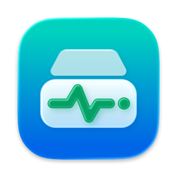
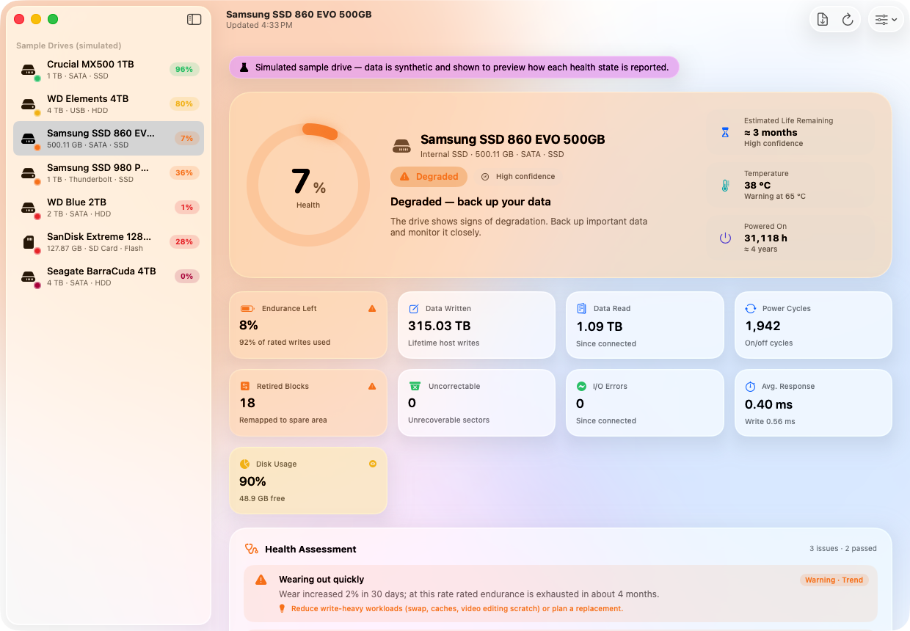

<p align="center">
  
</p>

<h1 align="center">Disk Health</h1>

<p align="center">A native drive health monitor for macOS that goes beyond S.M.A.R.T. pass/fail, with a Liquid Glass design.</p>

<p align="center">
  <picture>
    <source media="(prefers-color-scheme: dark)" srcset="docs/screenshot-dark.png">
    
  </picture>
</p>

## Features

- **Every kind of drive:** NVMe and SATA SSDs, hard drives, USB drives and SD cards, internal and external
- **More than pass/fail:** a graded status (Excellent, Good, Needs Attention, Degraded, **Pre-Fail**, Failed), a health percentage, and findings with a recommendation for each
- **Remaining life** from the drive's measured wear rate, with projected endurance (TBW) and how confident the estimate is
- **Full S.M.A.R.T. details:** the NVMe health log or every ATA attribute against its threshold, and the drive's own short and extended self-tests
- **Surface read test** that finds unreadable and slow regions, without ever writing to the drive
- **History** of temperature, wear and defects, so growing problems are flagged early
- **Notifications** when a drive's health gets worse
- **PDF reports** for one drive or all of them
- **Automatic updates** from this repository's releases, with the choice to install, wait or skip each version
- In English, Spanish, French, German, Italian, Portuguese (Brazil), Japanese, Korean and Chinese (Simplified), following your Mac's language

## Install

Download the latest `Disk-Health-x.y.z.dmg` from [Releases](https://github.com/advandz/disk-health-app/releases), open it and drag **Disk Health** to **Applications**.

Requires macOS 26 Tahoe or later; the app runs natively on Apple silicon and Intel. It isn't notarized, so if macOS can't verify it, choose **Open Anyway** in **System Settings → Privacy & Security**.

Disk Health checks this repository's tags about once a day, and whenever you choose **Disk Health → Check for Updates…**. When there's a newer version it shows the release notes and offers **Install Update**, **Later** or **Skip This Version**. Installing downloads the release's DMG, checks the app inside (bundle ID, version and code signature), swaps it in place and restarts. Automatic checks can be turned off in **Settings → Updates**.

## macOS Gatekeeper

Disk Health isn't notarized by Apple, so macOS Gatekeeper may stop it the first time you open it. You may see a message such as:

- “Disk Health” is damaged and can't be opened. You should move it to the Trash.
- “Disk Health” can't be opened because Apple cannot check it for malicious software.
- “Disk Health” is not safe to open.

The download isn't corrupt. macOS marks every app downloaded from the internet as quarantined, and Gatekeeper blocks quarantined apps that aren't notarized.

**To open it**

1. Drag **Disk Health** to **Applications**, then open it. When macOS blocks it, click **Done** (not **Move to Trash**).
2. Open **System Settings → Privacy & Security** and scroll down to **Security**.
3. Next to the message about Disk Health, click **Open Anyway**, then confirm with your password or Touch ID.

**If it says the app is damaged**

That message has no **Open Anyway** button. Remove the quarantine flag in Terminal, then open the app normally:

```bash
xattr -dr com.apple.quarantine "/Applications/Disk Health.app"
```

If the app isn't in **Applications**, use its actual path. Only do this for a copy you downloaded from this repository's [Releases](https://github.com/advandz/disk-health-app/releases) page.

## Use

- **Settings:** **Disk Health → Settings…** (⌘,) or the toolbar's Options menu.
- **Export a drive's report:** **File → Export Report as PDF…** (⌘E) or the toolbar's export button.
- **Export every drive:** **File → Export Report for All Drives as PDF…** (⌥⌘E). Each drive starts on a new page.
- **Sample drives:** **View → Show Sample Drives** (⇧⌘D) adds simulated drives in every health state. They're built from raw S.M.A.R.T. data, so they go through the same analysis as real drives.

A report has the drive's status, health and findings, remaining life, disk usage, temperature history, the last surface scan, the S.M.A.R.T. attributes or NVMe log, I/O statistics and device details. It uses your default paper size (A4 or US Letter), and its text is selectable.

## Build from source

You need Xcode 26, which compiles the Liquid Glass icon and the translations. Select it once:

```bash
sudo xcode-select -s /Applications/Xcode.app/Contents/Developer
xcodebuild -runFirstLaunch
```

Then build:

| Command | What it does |
|:--|:--|
| `./scripts/build-app.sh` | Builds the universal, ad-hoc signed app into `build/Disk Health.app`, and `build/Disk-Health-<version>.dmg` |
| `./scripts/build-app.sh --open` | Also opens it |
| `swift test` | Runs the parser, analyzer, history and scanner tests |
| `./scripts/update-strings.sh` | Adds new text from the code to `Resources/Localizable.xcstrings` and lists anything untranslated |
| `./scripts/make-icon.sh` | Re-renders the fallback icon, the README icon and previews from `Resources/AppIcon.icon` |

For development, `swift run DiskHealth` also works, in English, without the app icon, notifications or updates. The package opens in Xcode too (`open Package.swift`).

Translations live in `Resources/Localizable.xcstrings`; edit them in Xcode's String Catalog editor or in the JSON. To add a language, translate every key into it and the build picks it up.

The icon is an Icon Composer document, `Resources/AppIcon.icon`, with light, dark, clear and tinted appearances. Open it in Icon Composer to adjust it; its shapes are drawn by `scripts/icon-layers.swift` (`./scripts/make-icon.sh --layers` regenerates them).

## Release

The updater picks the highest version among the repository's tags, such as `v1.0.1` or `1.0.1`; pre-release tags like `v1.1.0-beta` are ignored. It installs the `.dmg` attached to that tag's GitHub release. To publish a version:

1. Set `VERSION` in `scripts/build-app.sh`.
2. Run `./scripts/build-app.sh`, which also writes `build/Disk-Health-<version>.dmg`.
3. Commit, then tag and publish the release with the DMG attached. Its notes appear in the update prompt.

   ```bash
   git tag v1.0.1 && git push origin v1.0.1
   gh release create v1.0.1 build/Disk-Health-1.0.1.dmg --title "Disk Health 1.0.1" --notes "What changed"
   ```

The app checks without signing in to GitHub, so the repository has to be public. If the newest tag has no release or no DMG, the prompt offers **View Release** instead. Installing in place needs the app in a folder it can write to, such as `/Applications` for an administrator, or `~/Applications`.

To try the updater without publishing anything, point it at a local copy of the API with the hidden `UpdateFeedURL` setting, for example `open "build/Disk Health.app" --args -UpdateFeedURL http://127.0.0.1:8765`. It expects `tags` and `releases/tags/<tag>` in GitHub's format there, and accepts plain HTTP only from this Mac. `VERSION=1.0.1 ./scripts/build-app.sh` builds a newer copy to serve.

## Command line

Write a PDF report without opening any window. It's saved after the first drive scan, for every drive, or for those whose name or ID matches `-ExportReportDrive`:

```bash
open "build/Disk Health.app" --args -ExportReportPDF ~/Desktop/disk-report.pdf
open "build/Disk Health.app" --args -ExportReportPDF ~/Desktop/ssd.pdf -ExportReportDrive "APPLE SSD"
```

`--demo` opens the window with only the sample drives, as in the screenshot above, and saves no history. Add `--light` or `--dark` to pick the appearance, and `-DemoDrive "<name>"` to pick the selected drive:

```bash
open "build/Disk Health.app" --args --demo --dark
```

To try another language once:

```bash
open "build/Disk Health.app" --args -AppleLanguages '(de)'
```

## What it monitors

| Source | Drives | Indicators |
|:--|:--|:--|
| **NVMe Health Log** (log page 02h, via Apple's `NVMeSMARTLib`) | Internal Apple SSDs, T2 Macs, Thunderbolt/PCIe NVMe | Critical-warning bits (spare, temperature, reliability, read-only, backup), percentage used (wear), available spare vs threshold, media & data-integrity errors, error-log entries, unsafe shutdowns, power cycles/hours, data read/written, time above warning/critical temperature, thermal throttling |
| **ATA S.M.A.R.T.** (via `ATASMARTLib`) | Internal SATA SSD/HDD; USB drives too if a SAT SMART driver is installed | Every attribute's normalized value vs threshold (pre-fail vs old-age), overall self-assessment, reallocated / pending / offline-uncorrectable sectors, reported uncorrectable errors, command timeouts, spin retries, end-to-end errors, CRC (cable) errors, NAND program/erase failures, SSD wear indicators (177/202/231/233/169…), load cycles, power-on age, self-test result, ATA error log count, SATA link speed |
| **I/O counters** (`IOBlockStorageDriver` statistics) | **All drives**, including USB sticks and SD cards | Read/write errors and retries since connected, average response time |
| **Surface read test** (optional, read-only) | All drives | Unreadable regions, very slow (weak) regions, latency distribution, throughput |
| **History** (stored locally) | All drives | Growth of defects over time, wear rate, observed daily usage, temperature chart |

How the results are graded:

- **Health %** starts from the drive's own wear indicator on SSDs, or 100 on HDDs. Each defect counter then applies a penalty, and serious findings cap the score, so a failing indicator never sits next to a high percentage.
- **Pre-Fail** needs an explicit critical indicator: 5 or more pending sectors or any growth in them, growing reallocated sectors or media errors, NVMe "reliability degraded" or "spare below threshold", unreadable regions in the surface test, or a failed self-test.
- **Failed** means the drive reports failure: its S.M.A.R.T. self-assessment failed, a pre-fail attribute crossed its threshold, or it went read-only.
- **Remaining life** for SSDs uses the wear rate measured over time once there's enough history, and before that, wear per power-on hour × daily usage (observed, or an assumed 8 h a day). For HDDs it uses power-on age against a typical service life, scaled by health, and is labeled low confidence. Drives without health data show "Not available" rather than a made-up number.
- **Confidence** shows how much data a report is based on: full S.M.A.R.T. gives high confidence, I/O counters alone give low confidence.

## Good to know

- macOS doesn't pass S.M.A.R.T. commands through USB bridges or card readers without a third-party driver. For those drives the app relies on I/O error counters and the surface read test, and says the result is low confidence. If a SAT SMART driver is installed, it's picked up automatically.
- The surface read test opens the disk read-only through Apple's `authopen`, which asks for an administrator password. The app never runs as root and never writes to the drive.
- The app isn't sandboxed, because macOS doesn't allow S.M.A.R.T. access from inside the App Sandbox. That's also why it's distributed here rather than on the Mac App Store.
- Health history is kept in `~/Library/Application Support/DiskHealth`, and nothing about your drives leaves your Mac. The only network request is the update check to GitHub.

## License

Copyright © 2026 Advandz Technologies, LLC. Released under the [MIT License](LICENSE.md).
